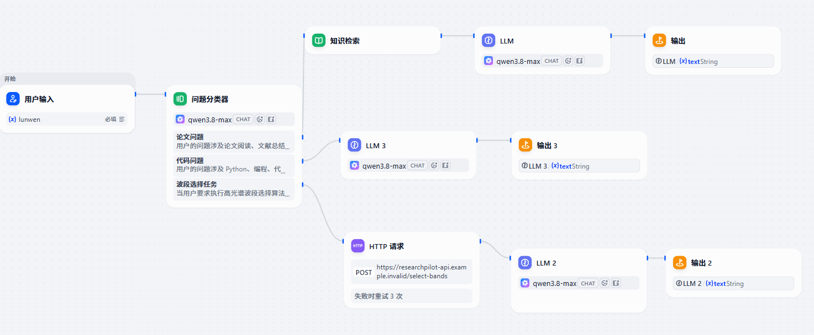

# ResearchPilot-Dify

ResearchPilot-Dify 是一个面向科研辅助场景的 Dify Workflow 作品集展示。它呈现了如何在一个可视化工作流中路由三类任务，并通过 RAG、LLM 与 FastAPI HTTP Tool Calling 串联论文问答、代码问答和高光谱波段选择。

本仓库面向 AI 应用开发实习岗位的技术评审：重点展示工作流设计、系统边界、接口契约和发布前安全处理，不提供私有科研算法、数据集或未发表实验结果。

## 三条工作流

1. **论文 RAG**：问题分类后检索 Dify 知识库，将召回上下文交给 LLM 生成论文相关回答。
2. **代码问答**：代码类问题直接进入独立 LLM 节点，用于解释、调试和优化建议。
3. **波段选择**：任务被路由到 HTTP Request 节点，按固定示例参数 `PaviaU / fisher / k=10` 调用 `/select-bands`，再由 LLM 解释结构化响应。

公开 DSL 保留了原工作流的全部 10 个节点、9 条连线、分支和 Prompt 逻辑。私有知识库 ID 已替换为待绑定占位值，本地 Docker 地址已替换为保留域名；因此导入后必须重新配置。

## 技术栈与职责

- **Dify Workflow**：输入、分类、分支编排、知识检索、HTTP 调用和结果生成。
- **RAG**：论文资料召回；知识库内容及标识不随仓库公开。
- **FastAPI**：私有环境中的 `/health` 与 `/select-bands` 接口适配层。
- **neurospec-agent（私有）**：真实 Fisher 等算法、PaviaU 数据读取和固定训练划分。

这不是自主 Agent Harness，也没有使用 LangGraph。工作流不会自主规划工具链；它执行预先定义的分类与分支。真实 Fisher 依赖 Python 3.14、私有 `neurospec-agent`、数据集与既有训练划分，本公开仓库不能独立执行真实算法。

## 仓库内容

```text
ResearchPilot-Dify/
├─ workflow/ResearchPilot-Public.yml
├─ docs/architecture.md
├─ docs/publication-checklist.md
├─ screenshots/dify-workflow-demo.png
├─ screenshots/README.md
├─ examples/request.json
├─ examples/response.example.json
├─ tests/test_public_artifacts.py
└─ reports/
   ├─ security-review.md
   └─ validation.md
```

## 导入后设置

1. 在 Dify 导入 `workflow/ResearchPilot-Public.yml`。公开 DSL 已在本地 Dify 界面成功导入；在其他环境使用时仍需按下列步骤重新配置。
2. 在“知识检索”节点中移除占位 ID，并重新绑定你有权使用的论文知识库。
3. 为问题分类器和三个 LLM 节点配置可用的模型提供商与模型凭据；仓库不包含凭据。
4. 将 HTTP Request 节点的 `https://researchpilot-api.example.invalid/select-bands` 改为部署环境可访问的 HTTPS 地址。
5. 在私有环境启动已授权的 FastAPI 服务，并先检查 `/health`；不要把私有数据、训练划分或算法包加入本仓库。
6. 使用 `examples/request.json` 做接口契约检查。`response.example.json` 仅为人工构造的格式示意，不是现场运行结果。

## 请求契约

```json
{
  "dataset": "PaviaU",
  "method": "fisher",
  "k": 10
}
```

私有 FastAPI 适配层接受 `POST /select-bands`。公开工作流仍固定发送上述参数，以便评审者清楚看到真实接口调用的位置；是否允许用户动态选择参数属于后续功能，不在本次完成范围。

## Dify 导入验证

公开 DSL 已在本地 Dify 界面成功导入。截图可核对 10 个节点、9 条连线，以及论文 RAG、代码问答、波段选择三条完整分支；HTTP Request 节点使用脱敏占位地址。



当前验证范围仅包括 DSL 导入和工作流结构，不代表知识库检索、LLM 调用或 HTTP/FastAPI 接口已经完成端到端运行验证。实际部署仍需重新绑定知识库、模型提供商、凭据和服务地址。

## 发布状态

本目录已按公开作品集方向脱敏，但不应在完成人工复核前直接发布。请先阅读 [安全审查](reports/security-review.md)、[验证报告](reports/validation.md) 和 [发布检查表](docs/publication-checklist.md)。

可在安装 `PyYAML` 与 `pytest` 的本地环境运行：

```powershell
python -m pytest -q
```

