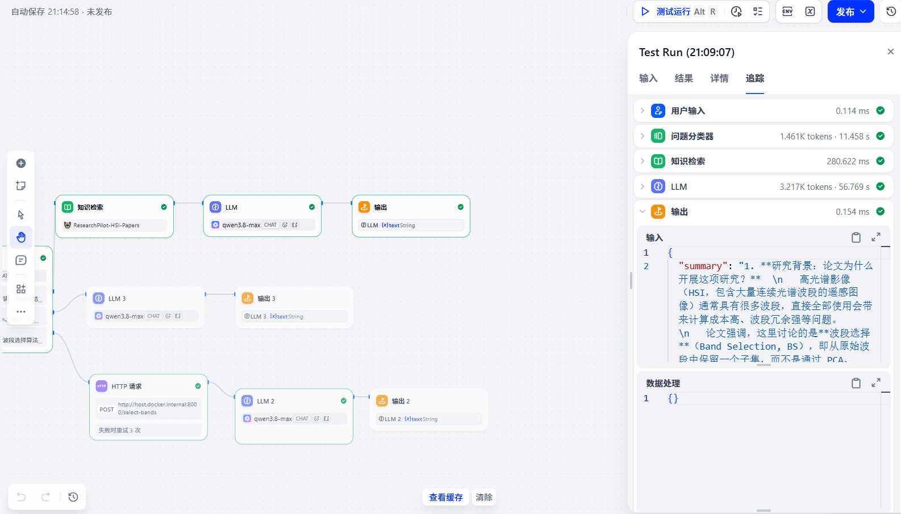
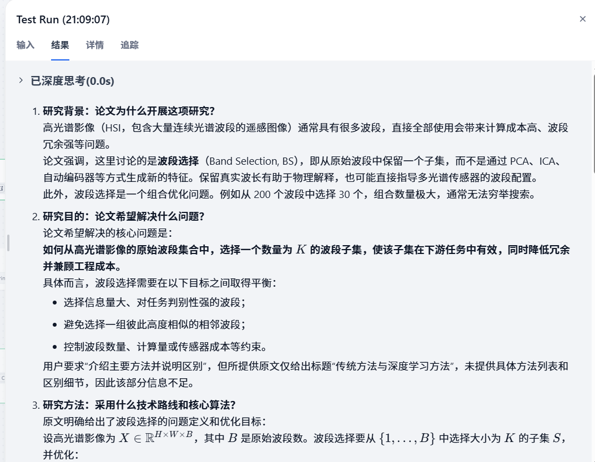
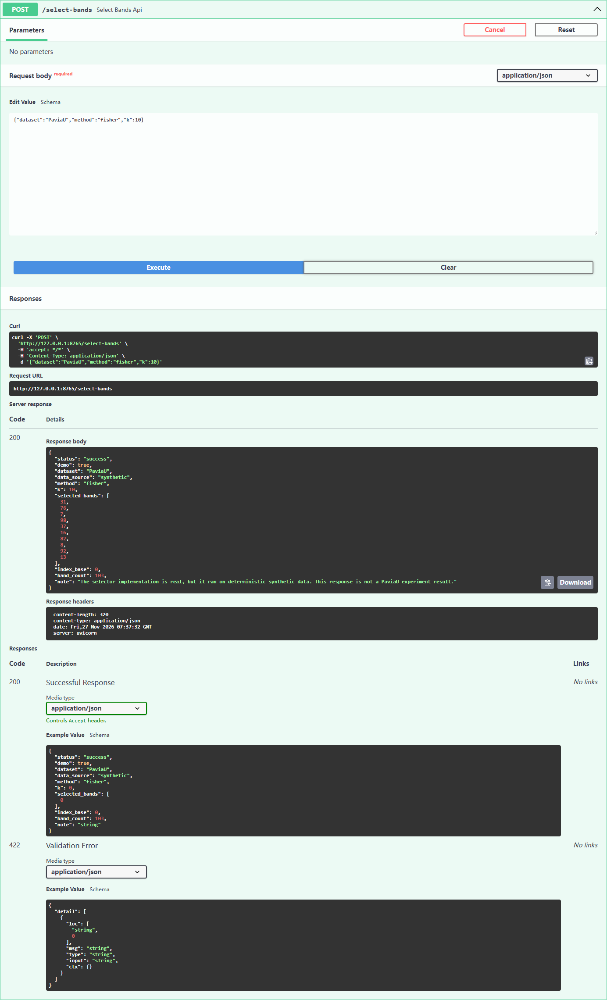
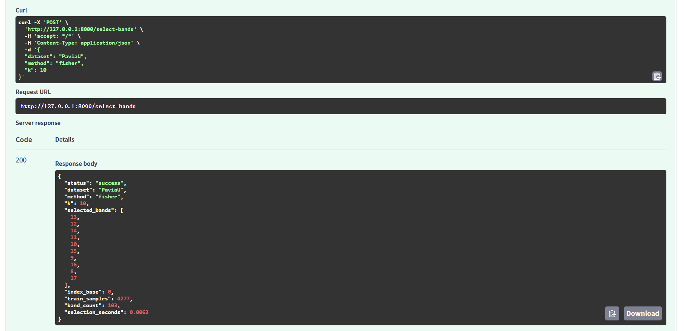
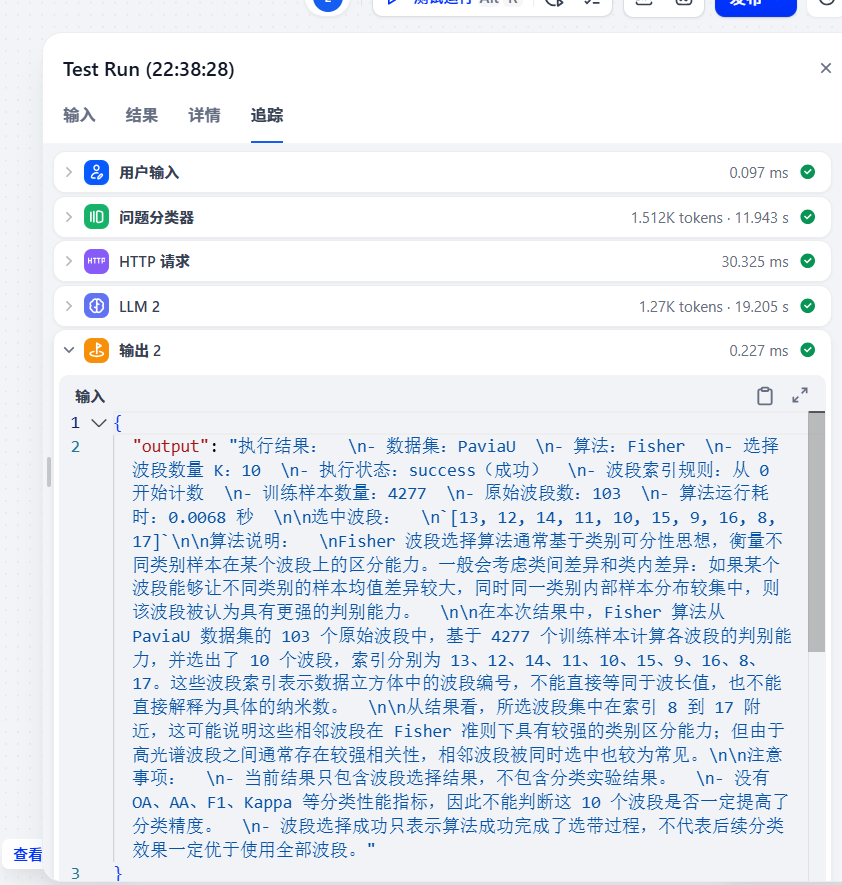

# ResearchPilot-satellite

ResearchPilot 是一个基于 Dify Workflow、RAG 与 FastAPI 的科研辅助应用，支持论文问答、代码问答和高光谱波段选择。

## 项目演示

### 1. Dify 三分支工作流

问题分类器将输入路由到论文 RAG、代码问答或波段选择分支，公开 DSL 保留 10 个节点和 9 条连线。


### 2. RAG 检索执行追踪

真实测试运行展示了问题分类、知识检索、LLM 生成和输出节点的完整执行链路。



### 3. RAG 问答结果

论文分支根据检索上下文生成结构化研究背景、研究目标和方法总结。



### 4. FastAPI Swagger 调用结果

公开 FastAPI Demo 实际执行 Fisher K=10；响应明确标记 `demo=true` 和 `data_source=synthetic`，可由当前仓库复现。



下面是原始私有科研环境调用真实 PaviaU/Fisher 接口时保存的 Swagger 200 响应。它不是 Mock，但依赖未公开的数据、训练划分和科研配置，不能由本仓库复现，也不作为公开 Demo 的实验指标。



### 5. Dify 调用 FastAPI 的 HTTP 结果

原始 Dify 波段选择分支已成功经过问题分类器、HTTP Request、LLM 解释和输出节点；截图中的结果来自上述私有科研环境，不是公开 synthetic Demo。



## 核心功能

- **论文 RAG**：从绑定的论文知识库检索上下文，再由 LLM 生成论文总结和研究问答。
- **代码问答**：为 Python、算法实现、调试和代码优化问题提供独立回答分支。
- **波段选择**：通过 HTTP Tool Calling 调用 FastAPI `/select-bands`，支持 Fisher、mRMR、MVPCA、Information Entropy、Random 和 Uniform。

## 技术栈

- Dify Workflow、RAG、HTTP Tool Calling
- FastAPI、Pydantic、Uvicorn
- NumPy、scikit-learn
- pytest、GitHub Actions

## 系统架构

[查看 Mermaid 系统架构与职责边界](docs/architecture.md)

浏览器输入由 Dify 分类并进入三个固定分支；波段选择分支调用 FastAPI，公开 Demo 再将请求分派到原科研项目中的传统选带实现。

## 个人工程贡献

- 设计 Dify 三分支工作流，完成分类器、知识检索、LLM、HTTP Request 和输出节点编排。
- 配置论文知识库检索链路，并验证 RAG 执行追踪和问答结果。
- 将 Dify HTTP 节点与 FastAPI `/select-bands` 接口连接，统一 Pydantic 请求和响应契约。
- 排查 Dify 容器访问宿主机服务的问题，使用 `host.docker.internal` 完成本地 Docker 网络联调。
- 开发 `/health`、`/select-bands` 和六种传统波段选择方法的调用适配层。
- 编写合成数据算法测试、API 测试、DSL 结构测试和 GitHub Actions 工作流。
- 对公开 DSL、截图、路径、知识库 ID 和服务地址进行发布前脱敏检查。

## 公开 Demo 与科研环境

### 公开 Demo

- FastAPI 使用确定性合成矩阵运行真实传统算法。
- 响应始终包含 `demo=true`、`data_source=synthetic` 和非 PaviaU 实验结果说明。
- `backend/neurospec/baselines/` 原样保留科研项目实际使用的 `base.py` 及六种传统算法文件。

### 原始 Dify + FastAPI

- 私有科研环境曾通过 Dify HTTP Request 调用真实 PaviaU 数据上的 Fisher 算法。
- 真实运行依赖 PaviaU 数据、固定训练划分和科研配置；这些内容未进入公开仓库。
- 公开 Demo 的截图和返回索引不能作为 PaviaU 实验结果或论文指标。

## 本地运行与测试

建议使用 Python 3.11、3.12 或 3.14：

```powershell
git clone https://github.com/siyuLi1213/ResearchPilot-satellite.git
Set-Location ResearchPilot-satellite
python -m venv .venv
.\.venv\Scripts\Activate.ps1
python -m pip install -r requirements-dev.txt
uvicorn backend.main:app --reload
```

打开 `http://127.0.0.1:8000/docs`，使用以下请求测试公开 Demo：

```json
{
  "dataset": "PaviaU",
  "method": "fisher",
  "k": 10
}
```

运行全部测试：

```powershell
python -m pytest -q
```

## 项目结构

```text
ResearchPilot-satellite/
├─ backend/
│  ├─ neurospec/baselines/   # 原项目传统算法
│  ├─ main.py                # FastAPI 入口
│  ├─ demo_selector.py       # 合成数据 Demo 适配器
│  ├─ selector_registry.py   # 六种公开算法分派
│  └─ schemas.py             # Pydantic 模型
├─ workflow/                 # 公开 Dify DSL
├─ screenshots/              # 真实演示截图
├─ tests/                    # API、算法与发布安全测试
├─ docs/                     # 架构和发布说明
├─ examples/                 # 请求与示例响应
├─ reports/                  # 安全与验证报告
└─ .github/workflows/        # 自动化测试
```

## 项目限制

- 公开 DSL 中的知识库 ID 和 HTTP URL 是安全占位值，导入后必须重新绑定。
- 仓库不包含 API Key、模型凭据、PaviaU 原始数据、训练划分、完整结构化实验结果或未发表性能指标；仅保留已明确标注边界的历史接口联调截图。
- 知识库、LLM 和部署后的 FastAPI 地址需要在目标环境重新配置。
- 当前项目是预定义的 Dify Workflow，不是自主 Agent Harness，也未使用 LangGraph。

