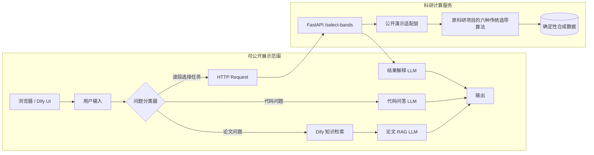

# 系统架构与边界

## 职责边界

- 浏览器与 Dify 负责交互和确定性工作流编排。
- Dify 知识检索节点负责从重新绑定的论文知识库召回上下文；公开仓库不含知识库内容和真实 ID。
- LLM 节点负责分类、论文回答、代码回答和接口结果解释；模型凭据由部署者在 Dify 中配置。
- FastAPI 提供 `/health` 与 `POST /select-bands`，并用 Pydantic 校验请求和响应。
- 公开模块原样收录科研项目中实际使用的 Fisher、mRMR、MVPCA、Information Entropy、Random 和 Uniform 实现；FastAPI 适配层不改写算法公式。
- 演示适配层仅生成确定性合成训练矩阵；数据文件、固定划分、凭据和未发表实验材料不纳入仓库。

## 波段选择数据流

公开 DSL 的 HTTP 节点固定发送 `dataset=PaviaU`、`method=fisher`、`k=10`。公开 FastAPI 接收同一契约，但会在合成矩阵上运行真实算法，并在响应中返回 `demo=true`、`data_source=synthetic` 和非 PaviaU 结果说明。该响应不代表论文实验指标。

## 可迁移性说明

公开 DSL 使用保留域名 `researchpilot-api.example.invalid`，避免泄露或误连本地服务。知识库 ID 使用显式占位值。两者均需在导入后的 Dify UI 中重新绑定。公开 DSL 已在本地 Dify 界面成功导入并核对图结构；该结论不代表知识库、LLM 或 HTTP 接口已完成运行验证。

