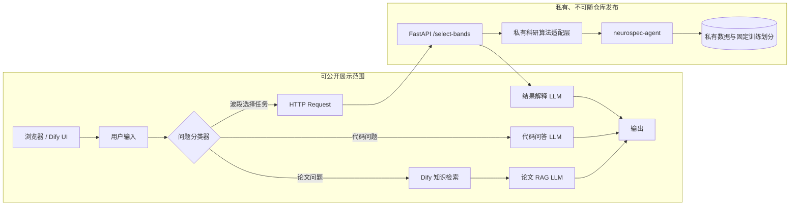

# 系统架构与边界

## 职责边界

- 浏览器与 Dify 负责交互和确定性工作流编排。
- Dify 知识检索节点负责从重新绑定的论文知识库召回上下文；公开仓库不含知识库内容和真实 ID。
- LLM 节点负责分类、论文回答、代码回答和接口结果解释；模型凭据由部署者在 Dify 中配置。
- FastAPI 只暴露受控请求模型和算法调用入口。当前私有适配层提供 `/health` 与 `POST /select-bands`。
- `neurospec-agent`、PaviaU 文件、固定训练划分、算法配置和实验输出留在私有科研环境。

## 波段选择数据流

公开 DSL 的 HTTP 节点固定发送 `dataset=PaviaU`、`method=fisher`、`k=10`。私有 FastAPI 校验请求后调用真实算法适配层，再返回索引和运行元数据。示例响应不来自现场执行，不代表任何论文指标。

## 可迁移性说明

公开 DSL 使用保留域名 `researchpilot-api.example.invalid`，避免泄露或误连本地服务。知识库 ID 使用显式占位值。两者均需在导入后的 Dify UI 中重新绑定。虽然 YAML 和图结构已检查，当前尚未在目标 Dify 版本中完成导入验证。

